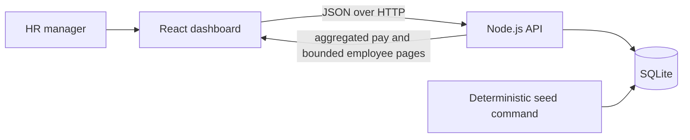

# Assessment notes

## Requirement traceability

| Assessment requirement | Delivered artifact or feature | Verification |
|---|---|---|
| One-page requirements written before implementation | [`requirements.md`](../requirements.md), committed before application code | First commit is `856720d` |
| End-to-end backend and UI | Node.js HTTP API, SQLite persistence, React dashboard and employee editor | `npm test`, `npm run build`, deployed HTTP/browser checks |
| Relational database | SQLite employee and salary-history tables with lookup indexes | Service tests use isolated SQLite databases |
| Seed 10,000 employees | Deterministic `npm run seed`; empty application database is seeded at server start | Test covers repeatable seeding; live summary reports 10,000 |
| Answer how the organization pays people | Payroll by country in local currencies; average/range by department and currency; employee directory | Analytics tests verify country/currency grouping and compensation ranges |
| Core salary management | Search/filter/sort/page employee records; edit salary/currency; timestamped salary history | Service tests cover filtering, bounds, validation, no-op behavior, and history |
| Fast, understandable unit tests | Node's built-in test runner and temporary SQLite databases | `npm test` |
| Production build | Vite optimized React bundle served by Node | `npm run build`; deployed UI and `/api/health` checked |
| Deployed software | Public Render free preview | [Live demo](https://acme-salary-management-2zoq.onrender.com) |
| Video demo | Short silent MP4 walkthrough using only synthetic records | [`demo/salary-management-demo.mp4`](../demo/salary-management-demo.mp4) |
| Incremental Git history | Requirements, backend, UI/tests, analytics refinement, deployment, demo, and bug-fix commits | Public [commit history](https://github.com/rohithellanki/acme-salary-management/commits/main) |

## Architecture

The UI requests aggregate dashboard data and one bounded employee page; it never downloads all 10,000 employee records for directory rendering. SQLite is the system of record for employee salary/currency and the salary-change history. SQL values are parameterized, sort columns are allowlisted, page size is capped, and salary inputs are validated before an atomic update/history insert.

## Product and engineering decisions

- **Keep currencies separate.** Country payroll totals and department averages/ranges are grouped with currency. Payroll numbers are not converted or added across currencies because no exchange-rate source, date policy, or accounting rule was specified. The location chart's bars show headcount, not a misleading cross-currency payroll comparison.
- **Keep the first release focused.** It manages and describes annual base salaries; it does not calculate payroll/tax/benefits, recommend compensation, import spreadsheets, or expose an employee self-service portal. Those require policy, integration, and privacy decisions beyond the assessment's core workflow.
- **Prefer a small deployable stack.** Node's built-in HTTP and SQLite APIs avoid a separate database service for a synthetic, 10,000-row demo. React/Vite gives the HR user a responsive web UI; the same Node process serves the built UI and JSON API.
- **Record changes.** Updates to salary or currency create a previous/new value and timestamp in the same transaction. No-op submissions do not create noisy history entries.
- **Optimize for the stated scale.** Employee reads are filtered and paginated server-side (10 by default, maximum 100). Summary values use SQL aggregation; country/department and name indexes support common lookups. For much larger datasets, add query-plan measurement, full-text/trigram name search, caching, and a managed relational database.

## Development and AI-assisted verification

Copilot SDK in VS Code was used as an AI coding assistant to help frame the requirements, implement the service/UI, and iterate on test failures and reported UX issues. Changes were made and reviewed in small, purpose-named commits rather than generating artificial history. Verification used deterministic Node tests, production builds, live API checks, and browser interaction checks (navigation highlighting, search/edit dialog, and refresh). AI suggestions were treated as implementation input and checked against runtime behavior and test results.

## Deployment and safety limits

The public Render deployment is a **free preview** using ephemeral SQLite storage and contains synthetic records only. Data may reset on restart/redeploy. It has no authentication or authorization and must not be used for real salaries or exposed as an ACME production system. A production rollout requires organization SSO, role-based access, secure hosting, durable encrypted storage/backups, controlled audit access, monitoring, retention policy, and privacy/compliance review. Render deployment configuration is in [`render.yaml`](../render.yaml).
